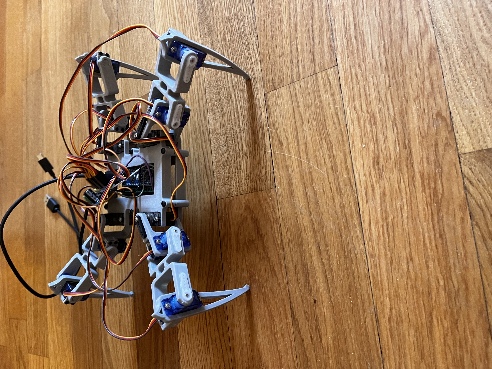
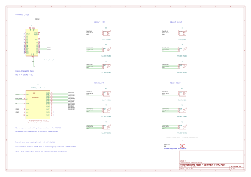

# Robot-quadruped
3D-printed quadruped robot prototype using Arduino Nano, PCA9685 and 12 servomotors.

# 3D-Printed Quadruped Robot

A personal robotics project built with 3D-printed parts, an Arduino Nano, and 12 servomotors controlled through a PCA9685 PWM driver.

The goal is to explore robotics, embedded electronics, and servo control.

## Overview

The robot features four legs with three servomotors each.

**Hardware:**
- Arduino Nano
- PCA9685 16-channel PWM servo driver
- 4 × MG90 and 8 × SG90 servomotors
- 3D-printed mechanical structure

## Electronics

The Arduino communicates with the PCA9685 via I²C (A4/SDA, A5/SCL). The servos use PWM channels 0–11 and require a separate power supply.

## My Contributions

- Assembled the 3D-printed robot and installed the servomotors.
- Selected and integrated the PCA9685 driver.
- Adapted the Arduino code for the PCA9685 with AI assistance.
- Created the electrical schematic using KiCad.

## Current Status

The mechanical assembly and wiring are complete. Walking functionality has not yet been tested due to the lack of a suitable external servo power supply.

Next steps: test the servos, calibrate joint positions, and develop a walking gait.

## Credits

Original design by Regis Hsu, including the mechanical parts, servo configuration, and original Arduino code.
(https://www.instructables.com/DIY-Spider-RobotQuad-robot-Quadruped/).

*Personal educational project — work in progress.*
